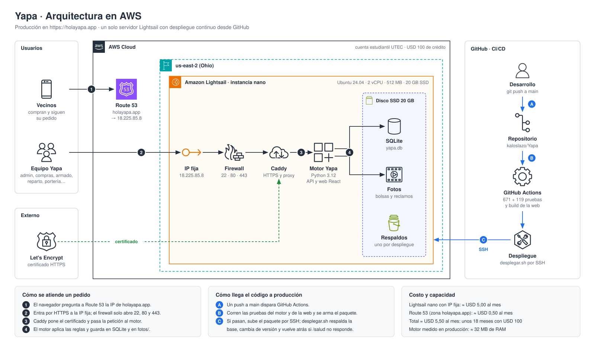

# Yapa

Compras grupales semanales entre vecinos de Lince, Jesús María y La Victoria: cada vecino paga el precio máximo, Yapa compra al por mayor y lo que se ahorra entre todos vuelve como saldo ("te devolvemos").

En producción en [holayapa.app](https://holayapa.app). Equipo: Carlos Bravo, Aaron Gonzales y Kalos Lazo. Se desarrolla con **Specification-Driven Development (SDD)**: cada regla del negocio tiene su spec, su prueba y su código.

## Cómo está armado

| Parte | Dónde | Qué hace |
|---|---|---|
| Tienda y paneles (React + TypeScript + Vite) | `src/` | La cara de Yapa: tienda del vecino, panel del admin de zona y centro de operaciones del equipo. **No calcula reglas.** |
| Motor (Python, solo biblioteca estándar) | `api/` | Todas las reglas del negocio, con sus specs y sus pruebas (`api/docs/desarrollo/99-registro.md` lleva la cuenta). Expone la API JSON en `/api`. |
| Specs, decisiones y evidencia | `api/docs/` | Una spec por iteración (`api/docs/desarrollo/NN-*.md`), registro, roadmap y preguntas al equipo. |

## Arquitectura en AWS



- **Route 53** resuelve `holayapa.app` y `www` a la IP fija del servidor.
- **Lightsail** (plan nano, Ohio) corre todo en una sola máquina:
  - **Caddy** da HTTPS con Let's Encrypt.
  - El **motor** en Python sirve la API y la web ya construida.
  - **SQLite** y las fotos viven en el disco, con un respaldo en cada despliegue.
- **GitHub Actions** prueba el motor y la web en cada push. Si es a `main`, sube el paquete por SSH y `desplegar.sh` cambia la versión y vuelve a la anterior si `/salud` no responde.
- Costo: unos **USD 5,50 al mes** con el crédito estudiantil. Detalle y comandos en [`deploy/aws/README.md`](deploy/aws/README.md).
- El diagrama usa los íconos oficiales de [AWS Architecture Icons](https://aws.amazon.com/architecture/icons/) (versión del 31/07/2026). El PNG para informes está en [`docs/img/arquitectura-aws.png`](docs/img/arquitectura-aws.png); para regenerarlo: `python3 docs/img/arquitectura/generar.py`.

## Levantar todo en local

Hace falta Python 3.11+ y Node 20+.

```bash
npm install
npm run api        # motor con una semana de demo ya vivida, en http://127.0.0.1:8000 (o: python api/tools/servir_demo.py)
npm run dev        # en otra terminal: la tienda en http://localhost:5173
```

Cuentas de la demo:

| Rol | Usuario | Clave |
|---|---|---|
| Vecina y admin de zona (Ana Torres, Los Álamos) | `101` | PIN `482915` |
| Vecina (Carmen Díaz) | `105` | PIN `739104` |
| Equipo Yapa | `admin-yapa` | `yapa-admin-2026` |
| Transportista (entrar como Reparto) | `reparto-demo` | `reparto-yapa-2026` |
| Proveedor de frescos (entrar como Proveedor) | `frescos-demo` | `frescos-yapa-2026` |
| Encargado de compras (entrar como Compras) | `compras-demo` | `compras-yapa-2026` |
| Armador (entrar como Armado) | `armado-demo` | `armado-yapa-2026` |
| Atención al cliente (entrar como Atención) | `atencion-demo` | `atencion-yapa-2026` |
| Portería de Edificio Los Álamos (entrar como Portería) | `porteria-demo` | `porteria-yapa-2026` |

Los vecinos entran en `/entrar`; el equipo, el reparto y los proveedores en `/equipo`. Para mandarle a cada persona su acceso con el rol ya elegido: `/equipo?rol=compras`, `armador`, `atencion`, `porteria`, `transportista`, `proveedor` o `admin`.

## Demo en línea (Render, alternativa)

Producción vive en AWS (arriba). Como alternativa gratis, `Dockerfile` y `render.yaml` arman la web y el motor en un solo servicio gratis. En Render: **New > Blueprint**, elige este repo y escribe las claves que pide:

| Variable | Qué es |
|---|---|
| `YAPA_ADMIN_USUARIO`, `YAPA_ADMIN_CLAVE` | administrador del equipo |
| `YAPA_DEBUG_CLAVE` | clave del admin global de la demostración (10 caracteres o más) |
| `YAPA_DEMO_PINS` | PIN de las cuentas de prueba, p. ej. `101=482915,105=739104,116=260318` |
| `YAPA_PUBLIC_URL` | la URL que da Render (`https://….onrender.com`), para las cookies seguras |
| `YAPA_PLIN_NUMERO` y `YAPA_PLIN_TITULAR` | el Plin negocios donde pagan los vecinos (iteración 58). Opcionales: sin ellos se usa una cuenta simulada (proyecto académico) |

El plan gratis se duerme sin visitas (tarda unos segundos en despertar) y borra el disco al reiniciar, así que la semana de demostración se vuelve a sembrar en cada arranque. Las cuentas del equipo, reparto y proveedor se crean desde "Cuentas del equipo".

## Qué se puede hacer

- **Vecino:** armar la canasta (cada producto muestra cuánto falta para el siguiente descuento y el ahorro frente al supermercado), pagar con Yape o Plin con el código que da Yapa, usar su saldo, ver lo que le devolvieron, cancelar con un botón, reclamar con foto e invitar vecinos con su código.
- **Admin de zona:** avance de su edificio hacia el mínimo de 8 pedidos, quién ya pidió, mapa con el radio de 300 m y las zonas cercanas para unirse, beneficios (envío gratis, 5 % las primeras 4 semanas y S/ 3 por invitado) y transferencia del rol.
- **Equipo Yapa:** verificar pagos, armar con foto, entregar, liquidar, crear las cuentas de reparto y proveedores, aprobar sus listas, resolver reclamos y devoluciones, conciliación del dinero, métricas del piloto, catálogo semanal, precios de referencia y alta de vecinos con consentimiento.
- **Transportista:** paradas de la semana con las bolsas de cada pedido y cómo llegar; registra la entrega con foto y nombre de quien recibe, o por qué no se pudo. No ve datos de los vecinos.
- **Proveedor aliado:** cuánto le compra Yapa de cada producto a su precio por tramo, y su lista de la semana siguiente para que el equipo la apruebe.

## Verificación

```bash
npm run typecheck && npm test && npm run build
cd api && PYTHONPATH=src python -m unittest discover -s tests     # Windows: $env:PYTHONPATH="src;tests"
```

El orden SDD de cada iteración (spec → pruebas en rojo → código → trazabilidad) se ve en `git log`. El historial del motor entró completo a `api/` con `git subtree`.
