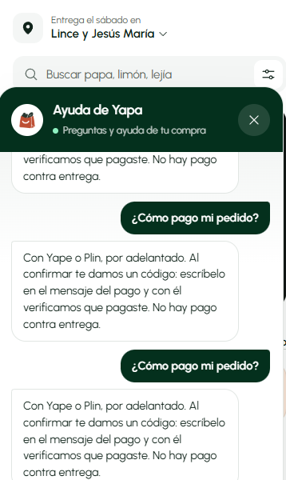

# Ayuda de Yapa como conversación

Rama `aaron/chatbot-faq`, actualizada a main `8b24c0e` el 17/11/2026. Conserva el asistente de compra con datos del vecino, las burbujas y la IA opcional incorporados por Kalos.

## Uso

«¿Te ayudamos?» abre el chat. Escribir una pregunta frecuente y enviarla agrega el mensaje del usuario y propone preguntas relacionadas. Elegir una añade la respuesta vigente de las FAQ compartidas por Explorar y Cómo funciona. Se conservan temas, búsqueda sin tildes, opciones iniciales y «Ver todas». Las nuevas respuestas quedan visibles al final de la conversación.

Si no hay coincidencia, se indica que no se encontró una respuesta segura y se ofrecen temas y «Consultar asistente de compra». No se inventa una respuesta. Las consultas personales reconocidas mantienen el endpoint existente con los datos autorizados del vecino y sus rótulos de fuente. Reiniciar descarta el historial y las respuestas que estuvieran en curso. Escape cierra y devuelve el foco.

Las FAQ y sus sugerencias son reglas locales: no requieren un LLM ni llaman a la API del asistente. El asistente personal o la opción explícita pueden utilizar la configuración de IA que ya tiene el proyecto; no se añadieron proveedores, claves, software o hardware. El historial de la pantalla vive en memoria, no se guarda como una conversación permanente.



## Arranque local

```powershell
cd "C:\Users\aaroo\Documents\DesignSoftware-projectU\Yapa-chatbot-faq"
npm.cmd ci
npm.cmd run build
python api/tools/servir_pruebas_roles.py --puerto 8021
```

Abrir http://ayuda.localhost:8021 y pulsar «¿Te ayudamos?». Probar «pagué», elegir una opción varias veces y comprobar el desplazamiento. Probar una pregunta desconocida y reiniciar. Ctrl+C detiene la demo. Para comprobar datos propios se requiere la sesión de un vecino de esa demo; no se usan cuentas de producción.

## Validación, 17/11/2026

- 764 pruebas del motor ejecutadas: 760 aprobadas y 4 omitidas. 214 pruebas web, TypeScript y build aprobados. Evidencia 73-chat-*-verde.txt en api/docs/evidencia/desarrollo.
- Pruebas de FAQ sin API, pregunta desconocida, reinicio con una respuesta pendiente y regresión del asistente con datos personales. Chrome a 390 px: cinco respuestas, la última dentro del área visible, y ninguna llamada al asistente para FAQ o consulta desconocida.
- [Spec y trazabilidad](../../api/docs/desarrollo/73-chat-conversacion.md). Permanece el aviso de Vite por chunk grande. No se modificó la infraestructura AWS ni se desplegó en producción.
