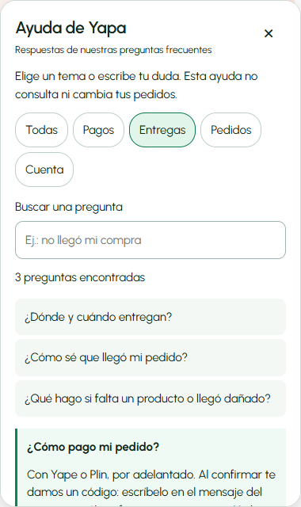
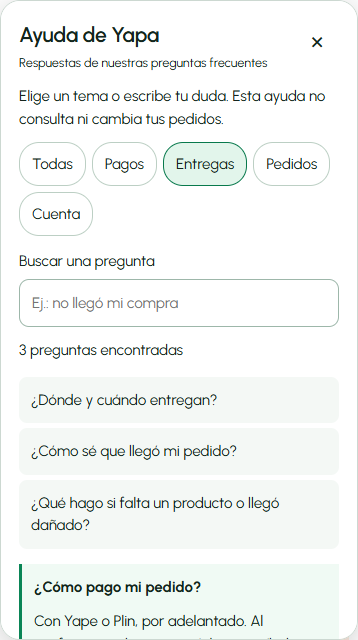

# Chatbot de preguntas frecuentes

Rama `aaron/chatbot-faq`, independiente de las otras dos funciones y basada en main `1942dea`.

El botón «¿Te ayudamos?» abre respuestas de las diez preguntas compartidas por Explorar y Cómo funciona. Hay filtros Pagos, Entregas, Pedidos y Cuenta, búsqueda sin tildes, sinónimos, selección de preguntas, historial de hasta seis respuestas y reinicio. Si no hay coincidencia, se indica; no se inventan respuestas.

Es búsqueda y reglas, no un LLM. No necesita una cuenta, clave, modelo descargado ni servicios extra en AWS. El historial vive en memoria del navegador, no se envía al backend ni consulta datos personales. Desplegar el frontend actualizado basta para habilitarlo. Las reglas de negocio siguen en el motor.





## Probar y arrancar

```powershell
cd "C:\Users\aaroo\Documents\DesignSoftware-projectU\Yapa-chatbot-faq"
npm.cmd ci
npm.cmd run typecheck
npm.cmd test
npm.cmd run build
python api/tools/servir_demo.py --puerto 8011 --estaticos dist
```

Abrir http://127.0.0.1:8011 y pulsar «¿Te ayudamos?». Buscar «PAGUÉ», elegir «¿Cómo pago mi pedido?», cambiar a Entregas y probar una consulta desconocida. Escape cierra y devuelve el foco. Detener con Ctrl+C. No usar 8000, reservado en esta computadora.

## Validación local, 14/11/2026

- 196 pruebas frontend aprobadas, TypeScript y build aprobados.
- Navegador Chrome de pruebas, escritorio y 390 px: búsqueda con tilde, respuesta, temas, sin coincidencias, Escape y foco. Capturas reales arriba.
- No cambió el backend. El aviso previo de Vite por un chunk mayor de 500 kB continúa.
- Se verificó funcionalmente en localhost; no se desplegó en producción.
