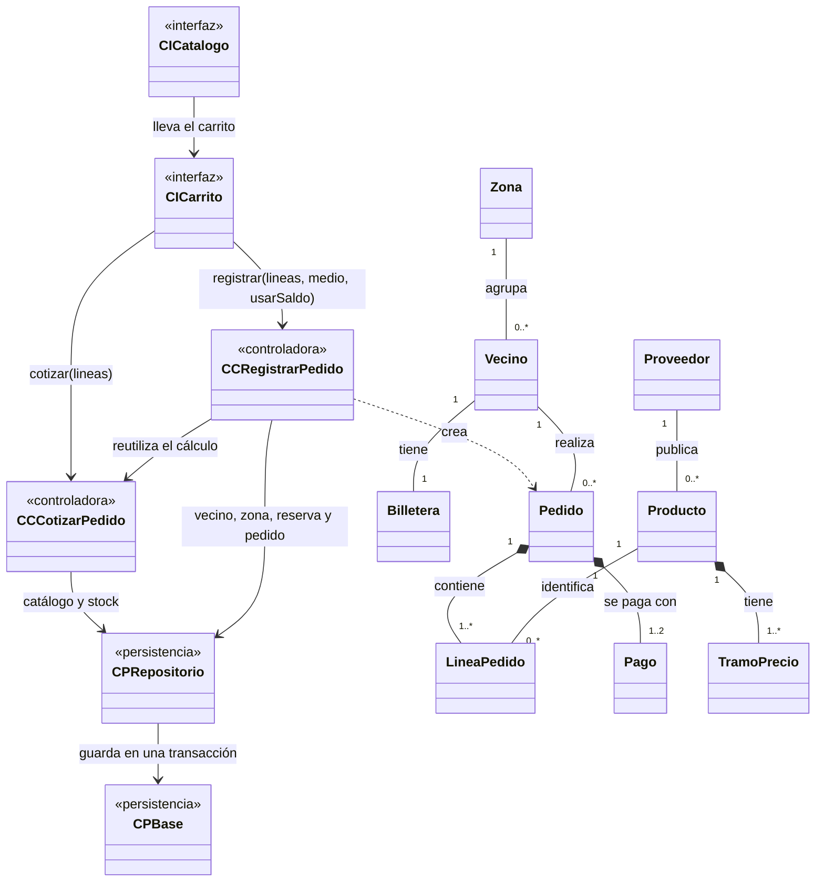
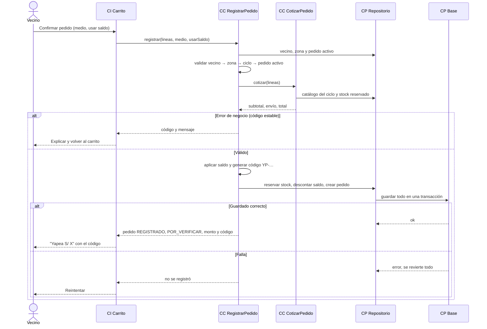

# Yapa — Análisis de CUS-P01 Registrar pedido semanal

**Versión:** 2, alineada con las reglas oficiales C-01..C-12 y con lo implementado en `api/` (iteraciones 2, 3, 4 y 26).
**Alcance:** colaboración de clases para cotizar y registrar un pedido. La verificación del pago es de CUN-03 y la liquidación ("te devolvemos") de CUN-04.

## 1. Propósito

Mostrar qué responsabilidades necesita el sistema para ejecutar [CUS-P01](cus-02-registrar-pedido.md), con la nomenclatura de la unidad 8: interfaz (CI), controladora (CC), persistencia (CP) y entidades. La última columna indica dónde vive cada responsabilidad en el código, para la trazabilidad.

## 2. Clases y responsabilidades

| Clase | Tipo | Responsabilidad | En el código |
|---|---|---|---|
| CI Catalogo | Interfaz | Mostrar los productos del ciclo con precio máximo y armar el carrito con − y +. | `src/components/Catalog.tsx`, `CartPanel.tsx` |
| CI Carrito | Interfaz | Mostrar la cotización, la casilla "Usar mi saldo", el medio de pago y la confirmación con el código. | `src/components/CartPage.tsx`, `CheckoutDialog.tsx` |
| CC CotizarPedido | Controladora | Validar líneas, cantidades y stock, y calcular subtotal, envío y total sin reservar nada. | `quote_order` en `order_registration.py` |
| CC RegistrarPedido | Controladora | Validar en el orden fijo de S-11, aplicar saldo, generar el código de pago y pedir el guardado. | `register_order` en `order_registration.py`; código de pago en `web/app.py` |
| CP Repositorio | Persistencia | Entregar vecino, zona, catálogo del ciclo y stock reservado; reservar stock y guardar el pedido. | `InMemoryStore` en `store.py` |
| CP Base | Persistencia | Guardar el estado completo después de cada operación exitosa, en una sola transacción. | `save` en `persistence.py` (SQLite) |
| Pedido | Entidad | Pedido del ciclo con estado, total y pagos. | `Order` |
| LineaPedido | Entidad | Producto, cantidad y precio máximo por unidad de cada línea. | `OrderLine` |
| Pago | Entidad | Medio (Yape, Plin o saldo), monto, código y estado de verificación. | `Payment` |
| Vecino | Entidad | Titular del pedido, con su zona y su estado (suspendido o no). | `Customer` |
| Zona | Entidad | Punto de recepción con distrito, coordenadas, admin y estado. Reemplaza a Dirección. | `Zone` |
| Producto | Entidad | Artículo del catálogo del ciclo con categoría, unidad, paso, tramos de precio y stock máximo. | `Product` |
| TramoPrecio | Entidad | Precio del proveedor desde una cantidad total; el primero define el precio máximo. | `PriceTier` |
| Proveedor | Entidad | Proveedor aliado que publica la lista semanal. | `Supplier` |
| Billetera | Entidad | Saldo a favor del vecino, que puede usar al pagar. | `wallet.py` |

Cambios frente a la versión 1:

- **Se elimina `VentanaEntrega`.** Yapa asigna la ventana a la zona (S-10), así que el pedido no reserva cupo.
- **`Direccion` pasa a ser `Zona`** (C-07).
- **`Cotizacion` pasa a ser `TramoPrecio` dentro de `Producto`** (C-12): el precio depende del volumen total y del catálogo del ciclo.
- **Se agregan `Pago` y `Billetera`.** El pedido puede pagarse con Yape o Plin más saldo (iteración 3).

## 3. Diagrama de clases de análisis

`Pago 1..2`: como máximo un pago con saldo y uno con Yape o Plin (S-148).

## 4. Secuencia de registro

Corresponde a los pasos 5 a 7 del caso de uso.

El servidor atiende las solicitudes con un cerrojo (iteración 44), así que dos pedidos no pueden reservar a la vez el último stock.

## 5. Preguntas resueltas de la versión 1

| Pregunta | Respuesta |
|---|---|
| ¿El medio de pago va en Pedido o aparte? | Aparte: `Payment`, uno por medio. Elegir un medio no verifica el pago; lo verifica el admin (CUN-03). |
| ¿Cómo modelar ventanas y capacidad? | Ya no aplica: la ventana es de la zona (S-10). |
| ¿Cómo conservar el precio aceptado? | Cada `OrderLine` guarda su precio máximo por unidad al registrar (C-01). |
| ¿Cómo evitar pedidos duplicados? | Un solo pedido activo por vecino y ciclo (RP-04, CE-06); el doble clic devuelve `ORDER_ALREADY_EXISTS`. |
| ¿Qué pasa con la canasta al cierre? | Se rechaza con `CYCLE_CLOSED` (S-02); no pasa al siguiente ciclo. |
| ¿Sustituciones? | No hay: un faltante se devuelve por artículo en la liquidación (C-10). |

El modelo de datos (tablas, claves y restricciones) queda para el documento de modelo de datos y arquitectura, que todavía falta.
