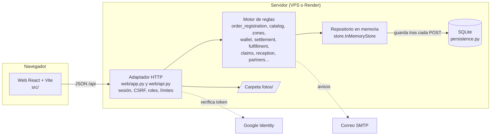
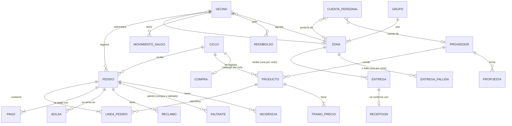
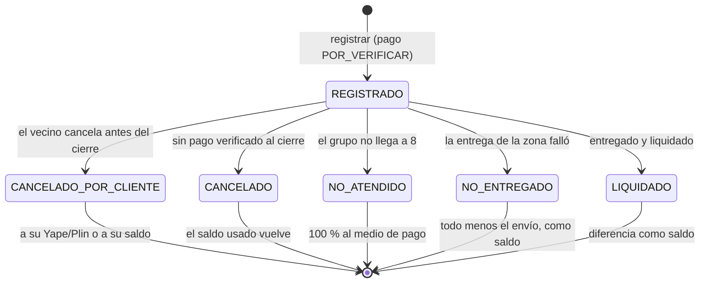

# Yapa — Modelo de datos y arquitectura

Describe cómo está construido Yapa hoy (iteración 57). Las clases y atributos salen del código en `api/src/yapa_sdd/`; los casos de uso están en [`cus/`](cus/README.md).

## 1. Arquitectura



| Capa | Qué hace | Decisión y motivo |
|---|---|---|
| Web (`src/`) | Tienda, Mi cuenta, página de la zona y paneles por rol (equipo, proveedor, transportista, portería). | React + TypeScript con Vite. No tiene reglas de negocio: muestra lo que responde la API. |
| Adaptador HTTP (`web/`) | Rutas `/api/*`, sesión en el servidor con cookie `HttpOnly`, token CSRF en cada POST, permiso por rol en cada ruta, límites por dirección, CSP y HSTS. | Solo biblioteca estándar de Python (WSGI). Atiende con hilos y un cerrojo, así que dos pedidos no reservan a la vez el último stock (iteración 44). |
| Motor (`yapa_sdd/*.py`) | Todas las reglas de negocio, con un código de error estable por regla (`BusinessRuleError.code`). | Funciones puras sobre el repositorio, probadas sin levantar el servidor (SDD: spec → prueba → código). |
| Repositorio (`store.py`) | Colecciones en memoria: vecinos, zonas, pedidos, catálogos, billetera, entregas, reclamos… | Simple y rápido para el piloto (decenas de zonas). |
| Persistencia (`persistence.py`) | Después de cada POST exitoso guarda el estado completo en SQLite, en una transacción. | Todo o nada: si falla, no queda un estado a medias. Al cargar solo se reconstruyen clases del propio paquete. |

**Despliegue.** Un push a `main` corre las pruebas del motor y de la web en GitHub Actions; si pasan, el runner de la VPS instala el paquete y vuelve a la versión anterior si el motor nuevo no responde en `/salud` (iteración 52). La demo pública corre en Render con el `Dockerfile` y `render.yaml`, y siembra la semana de demostración al arrancar.

## 2. Modelo de datos (lógico)



### Entidades

| Entidad | Clase | Atributos principales | Reglas que la tocan |
|---|---|---|---|
| Vecino | `Customer` | id, nombre, zona, suspendido, ubicación, celular, correo verificado, consentimiento (Ley 29733), quién lo invitó, cuenta de Google, fecha de retiro | RP-01, ZN-03, S-133, S-304 |
| Zona | `Zone` | id, nombre, distrito, grupo, costo de parada, ubicación, admin, tipo y contacto de recepción, estado | C-07, ZN-01..ZN-07 |
| Producto | `Product` | id, nombre, categoría (`FRESCOS`/`LIMPIEZA`), unidad, paso, máximo del proveedor, tramos, activo, proveedor | C-11, C-12, CT-01..CT-11 |
| Tramo de precio | `PriceTier` | desde (cantidad), precio base | CT-03, LQ-04 |
| Proveedor | `Supplier` | id, nombre, aliado | CT-02 |
| Pedido | `Order` | id, ciclo, vecino, zona, líneas, subtotal, envío, total, pagos, estado | RP, CE, LQ |
| Línea de pedido | `OrderLine` | producto, cantidad, precio máximo por unidad (fijado al registrar) | C-01 |
| Pago | `Payment` | medio (`YAPE`/`PLIN`/`SALDO`), monto, código, estado (`POR_VERIFICAR`/`VERIFICADO`) | C-03, C-04, RP-15 |
| Movimiento de saldo | `Movement` | vecino, tipo, monto (+ abono / − cargo), fecha, referencia | BS-01..BS-15 |
| Reembolso | `Refund` | id, vecino, monto, motivo, fecha de pedido, fecha límite, estado, código de operación | BS-12, BS-13 |
| Bolsa | `Bag` | pedido, número, foto, armado por, fecha | AR, AM |
| Entrega | `Delivery` | ciclo, zona, pedidos, foto, quien recibe, tipo de recepción, entregado por, fecha | EN, TR |
| Entrega fallida | `FailedDelivery` | ciclo, zona, pedidos, foto, motivo, registrado por, fecha | EF |
| Recepción | `Reception` | ciclo, zona, pedidos, confirmado por, fecha | PO |
| Reclamo | `Claim` | id, pedido, vecino, producto, cantidad, motivo, foto, estado, monto devuelto | RC, RV |
| Compra real | `Purchase` | ciclo, lo recibido por producto, quién y cuándo | CR, S-295 |
| Faltante | `Shortage` | ciclo, pedido, producto, cantidad, cuánto repuso el colchón, origen (compra o dañado), foto | CR-05, DA, S-296, S-297 |
| Incidencia | `Incident` | id, pedido, tipo, descripción, estado, nota de cierre, quién y cuándo | IN, S-300 |
| Cuenta de personal o socio | `Partner` | usuario, tipo (proveedor, transportista, compras, armado, atención, portería), nombre, zona o proveedor | CX, S-278..S-294 |

**Ciclo.** No es una clase: es la semana ISO (`2026-W38`), que abre el lunes 00:00 y cierra antes del miércoles 20:00 (S-02). Las colecciones que dependen de la semana usan el ciclo como parte de su clave: catálogo, stock reservado, entregas, recepciones y propuestas.

### Estados del pedido



## 3. Modelo físico

Para el piloto, el repositorio completo se guarda en una tabla clave-valor de SQLite:

```sql
CREATE TABLE estado (clave TEXT PRIMARY KEY, valor TEXT NOT NULL);
```

Cada colección del repositorio (por ejemplo `orders`, `zones` o `movements`) es una fila, con su valor en JSON y marcas de tipo (`$dec`, `$dt`, `$tuple`…) para no perder la precisión de los montos. Se reescribe entera, en una transacción, después de cada operación que cambia algo (iteración 11).

**Por qué así.** Con decenas de zonas y cientos de pedidos por semana, guardar el estado completo es más simple que mantener un ORM. Además garantiza el todo o nada sin repartir transacciones por todo el motor.

**Cuándo cambiarlo.** Si el piloto crece a miles de pedidos por semana, cada colección del diagrama pasa a ser una tabla con las relaciones de la sección 2. El motor no cambia, porque solo habla con `InMemoryStore`.

## 4. Seguridad y datos personales

- **PIN y contraseñas:** hash PBKDF2 con sal; bloqueo tras 5 fallos; cambiar el PIN cierra las demás sesiones.
- **Datos que ve cada rol:** el transportista y la portería no ven montos ni celulares; el armador no ve pagos.
- **Consentimiento (Ley 29733):** se registra la fecha en el alta. Si el vecino lo retira, se borra lo que lo identifica (nombre, celular, correo, ubicación, Google, PIN) y se conservan sus pedidos y su dinero sin datos personales (iteración 57).
- **Fotos:** se guardan con su tipo real y solo las ve quien las necesita.
