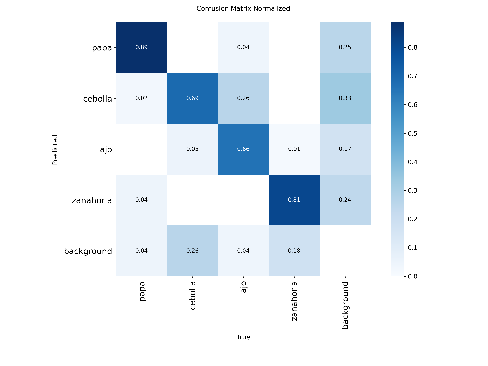
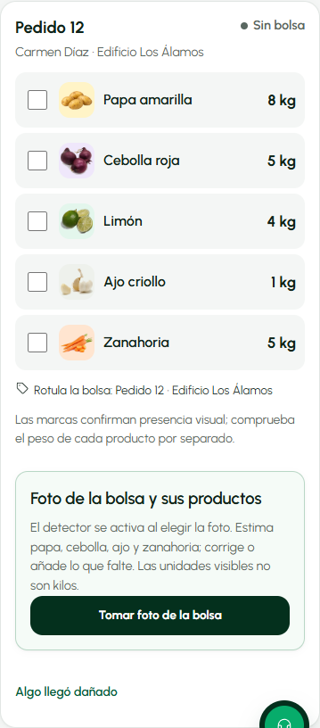
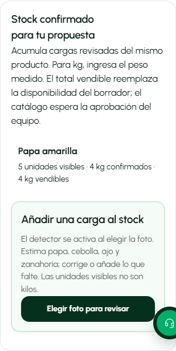

# YOLOv8 Small para revisión por foto

Rama `aaron/modelo-yolo`, actualizada a main `8b24c0e` el 17/11/2026. Incluye las mejoras de Armado y Proveedor; conserva el lector de cotizaciones y el despliegue de visión incorporados por Kalos.

## Modelo y alcance

Se incluye `api/src/yapa_sdd/modelos/vegetable4-v8s.pt`, 22.521.578 bytes (21,48 MiB), SHA-256 `ddcc76ea30070e9cd05baf71c5792d644c3c8edf7abea381b55483ab594144b6`. Es best.pt del ZIP de Colab de Vegetable 4. El archivo «yolov8s (2).pt» de Descargas tiene 80 clases COCO y NO es el entrenado para Yapa.

Clases: papa, cebolla, ajo y zanahoria. No reconoce por entrenamiento limón o camote ni distingue papa blanca/amarilla. El detector suma cajas para sugerir cuántos objetos visibles hay de cada producto. No convierte unidades a kilos ni descubre contenido oculto.

Se solicitaron 75 épocas con patience=20; results.csv contiene 47 épocas ejecutadas. La parada anticipada explica que no llegara a las 75.

## Resultados del test de Colab

| Métrica | Resultado | Qué significa |
|---|---:|---|
| Precisión | 56,64 % | Resume la proporción de detecciones correctas bajo la evaluación utilizada. Hay falsos positivos. |
| Recall | 62,58 % | Resume cuánto de lo etiquetado logró detectar; puede omitir productos. |
| mAP50 | 57,04 % | Calidad media de detección con coincidencia de cajas a IoU 0,50. No equivale a acertar el conteo en el 57 % de bolsas. |
| mAP50–95 | 33,44 % | Evaluación más exigente de la localización de las cajas. |

Estas métricas son las exportadas de test, no una nueva evaluación realizada aquí ni la precisión exacta del umbral 0,35 de la aplicación. [Datos originales](metricas_test.json).

Es un prototipo referencial que exige revisión humana. Small prioriza un coste moderado frente a modelos mayores; NO se demostró que su tamaño sea la causa de los errores. Solo hay cuatro clases, por lo que no sería correcto justificarlos por un gran número de frutas. Sí hay variedad visual de tamaños, formas, fondos y oclusiones. El ZIP venía redimensionado a 416×416; entrenar a 640 no recupera detalle perdido. El test tiene 81 fotos (entre 18 y 24 con cada producto), y el agrupamiento de nombres/hashes no garantiza independencia completa. Hacen falta fotos nuevas de bolsas de Yapa y revisar etiquetas para medir su utilidad real.


En results.png, las pérdidas muestran el ajuste de cajas/clases y las curvas de métricas el comportamiento de validación a lo largo de las épocas. Una pérdida de entrenamiento menor no garantiza mejor funcionamiento real.



Columnas: etiqueta real. Filas: predicción. La diagonal recoge coincidencias; fuera de ella hay confusiones, como ajo/cebolla. La fila background indica objetos omitidos y la columna background detecciones sin objeto coincidente. Sus cifras dependen del criterio de evaluación; no son porcentajes de bolsas bien contadas.


La curva PR muestra el intercambio entre detectar más objetos y producir falsos positivos al variar el umbral. El servidor utiliza conf=0,35. Las puntuaciones que muestra el detector no garantizan que el conteo sea correcto.

## Prueba con las fotos del catálogo (18/11/2026)

Se pasaron por `/api/vision/analizar` las 16 fotos de `public/images/products` (umbral 0,35). Son fotos de catálogo, no de bolsas armadas, pero son nuestros productos:

| Foto | El detector dice | ¿Bien? |
|---|---|---|
| Papa amarilla | papa ×4 | sí |
| Cebolla roja | cebolla ×3 | sí |
| Ajo | cebolla ×3, ajo ×1 | a medias |
| Papa blanca | cebolla ×1 | no |
| Zanahoria | papa ×4, zanahoria ×2 | no |
| Camote | papa ×4, cebolla ×1 | no |
| Tomate italiano | cebolla ×2 | no |
| Limón | cebolla ×2 | no |
| Plátano de seda | zanahoria ×2 | no |
| Leche en pack | cebolla ×2 | no |
| Limpiatodo | ajo ×1, zanahoria ×1 | no |
| Aceite, arroz, detergente, lavavajillas, lejía | nada | sí |

Acierta 2 de las 11 fotos donde sugiere algo. Por eso, desde la iteración 76, el detector no corre solo: es una ayuda opcional.

## Uso en las pantallas (desde la iteración 76)

> Desde la iteración 77, «Sugerir con el detector» pregunta primero a la IA de visión de Groq con la lista del pedido (o de los productos del proveedor) y este modelo queda de respaldo cuando no hay IA o se acabó el cupo. Comparación en [banco-18nov.md](banco-18nov.md).

- Armado: «Tomar foto de la bolsa» registra la bolsa al elegir la foto, sin otro toque (S-331). Después, «Revisar la foto con el detector (opcional)» muestra «Sugerir con el detector»: solo aparecen sugerencias de productos del pedido (las demás se descartan y se dice cuántas). Las filas confirmadas se guardan en esa bolsa con «Guardar revisión de la bolsa» y marcan la lista del pedido. «Quitar bolsa» pide confirmación, funciona antes del despacho y conserva la foto.
- Proveedor: en «Stock confirmado para tu propuesta» se elige la foto de la carga y, si sirve, «Sugerir con el detector» (solo productos de su lista). Se corrigen producto y unidades, se ingresa el peso medido cuando se vende por kg y se confirman las filas. El total vendible llena el borrador; publicar sigue pidiendo la aprobación del equipo.
- El sistema nunca pasa unidades visibles a kilos ni cambia precios. La misma foto exacta no se suma dos veces al stock.
- Se conserva «Leer cotización con IA» (iteración 69): leer una lista con precios y contar verduras son cosas distintas.

Las capturas de abajo son de la versión del 17/11, cuando el detector corría solo.





## Instalación y arranque local

Con Python 3.11 o 3.12, sin GPU, desde la raíz del repo:

```bash
python3 -m venv api/.venv
api/.venv/bin/pip install torch torchvision --index-url https://download.pytorch.org/whl/cpu
api/.venv/bin/pip install -r api/requirements-vision.txt
npm ci
npm run demo   # usa api/.venv si existe, así el detector funciona
```

Otra opción, con la demo de roles de Aaron:

```bash
npm ci && npm run build
api/.venv/bin/python api/tools/servir_pruebas_roles.py --puerto 8023
```

Abrir http://yolo.localhost:8023/equipo?rol=armador, usuario `armado-demo`, clave `armado-yapa-2026`; o `?rol=proveedor`, usuario `frescos-demo`, clave `frescos-yapa-2026`. La demo crea pedidos y pagos ficticios en memoria en tres zonas y fija el jueves 01/10/2026 después del cierre; no toca bases existentes. Sus fotos se guardan en una carpeta temporal y se descartan al cerrar esta demo. Ctrl+C detiene el servidor. La demo habitual también sirve, pero puede no alcanzar el mínimo de pedidos.

## AWS y dependencias

Según [la documentación de Kalos](../../deploy/aws/README.md), el 16/11 se habilitaron las dependencias de visión en el servicio y se amplió Lightsail a 2 GB. Esta revisión no accedió a AWS ni modificó su configuración. El modelo ya forma parte de `api/src`; el dataset no se sube. El Dockerfile habitual no instala las dependencias opcionales.

El backend sigue arrancando sin PyTorch/Ultralytics: se importan al solicitar análisis. Si faltan, queda la revisión manual. No hay instalación automática durante una petición. Para una instalación nueva se necesitan las dependencias de `api/requirements-vision.txt` en el Python que ejecuta el servicio, además de memoria suficiente; el peso del archivo no representa la RAM necesaria.

## Validación actual, 17/11/2026

- Regresión conjunta de Armado y stock: 774 pruebas del motor (770 aprobadas, 4 omitidas), 216 web, TypeScript y build aprobados. Los últimos ajustes de selección repetida de foto, unidad del borrador y cámara se comprobaron con las pruebas relacionadas y un nuevo build. Evidencia en `api/docs/evidencia/desarrollo/71-armado-*` y `72-stock-*`.
- Chrome real a 390 px con API y YOLO locales: detectar zanahorias, corregir a 2, confirmar el SKU, comprobar el check superior, guardar, recargar y quitar la bolsa. Una foto se mantiene como una bolsa.
- Dos fotos de papa: 2 + 3 unidades visibles y 1,25 + 2,75 kg medidos producen 5 unidades y 4 kg confirmados. Se verificaron la recarga, el máximo de 4 kg en el borrador y que repetir la foto no sume otra vez. Precios plegados y lector de cotizaciones conservados.
- No se reentrenó el modelo. Permanecen el aviso Vite por chunk grande y el ResourceWarning SQLite de la suite. [Decisiones y alineación](../propuestas/alineacion-17nov.md), [spec de Armado](../../api/docs/desarrollo/71-armado-unificado.md), [spec de stock](../../api/docs/desarrollo/72-stock-confirmado.md).

## Validación histórica, 14/11/2026

- 729 pruebas del motor: 725 aprobadas y 4 omitidas. Roles permitidos, anónimo/vecino denegados, CSRF, tamaño/foto requerida y conteo por cajas. Sin dependencias de visión, las pruebas generales siguen pasando.
- 194 pruebas frontend, TypeScript y build aprobados. Correcciones, recuperación manual, fallo al guardar y respuesta antigua de otra foto cubiertos.
- Prueba funcional real con el best.pt y cuatro fotos del test: papa 1/1, cebolla 1/1, ajo 2/3 y zanahoria 3/3, en formato detectado/etiquetado. Es una muestra de funcionamiento, NO una estimación estadística nueva. [Respuestas y tiempos](prueba-local.json). Primera carga del modelo unos 6,7 s; siguientes fotos de esa prueba unos 0,12–0,15 s en esta CPU.
- Chrome de pruebas, escritorio y 390 px: Armado detectó 3 zanahorias, permitió corregir a 2 y guardó la misma foto como una bolsa. Proveedor detectó 2 ajos, permitió corregir a 3 y confirmó sin publicar una propuesta. Se verificó el rechazo de una foto inválida. No se entrenó de nuevo.
- Entorno de inferencia: Python 3.12, Ultralytics 8.4.211, PyTorch 2.15.0+cpu. La regresión general también se ejecutó en Python 3.14.7. Avisos previos: chunk Vite >500 kB y ResourceWarning SQLite durante pruebas del motor.
- En esa validación del 14/11 no se había desplegado ni hecho push. La validación actual se describe arriba.

## Fuente

Vegetable 4, Upwork3, versión 1, licencia declarada CC BY 4.0: https://universe.roboflow.com/upwork3/vegetable-4-fhius/dataset/1. Se seleccionaron cuatro clases, se renumeraron y se depuraron los conjuntos. El modelo entrenado y las capturas de prueba derivan de ese dataset. [Atribución exportada](FUENTE_DATASET.txt), [auditoría](auditoria.json), [parámetros](args.yaml). No se suben las 11.542 imágenes ni el ZIP del dataset.
