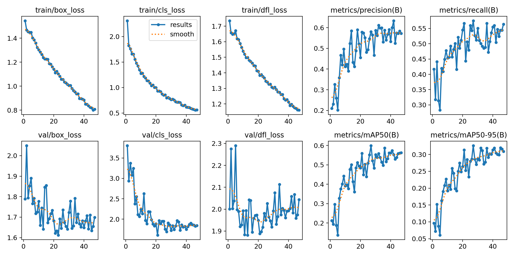
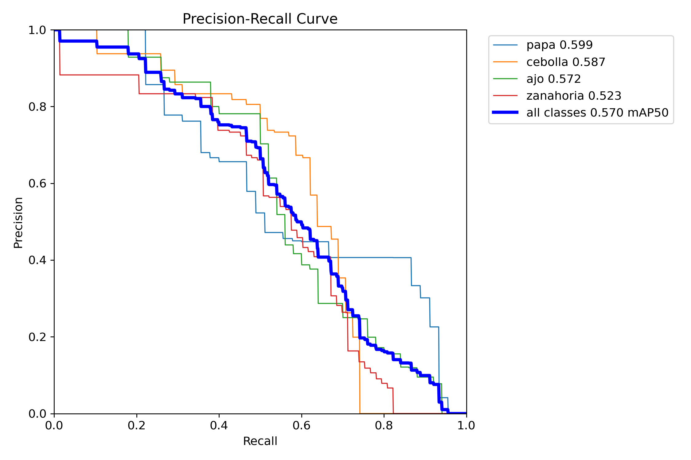
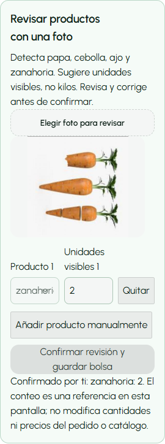
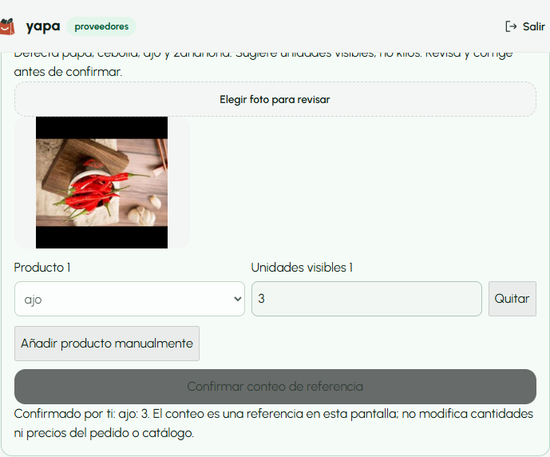

# YOLOv8 Small para revisión por foto

Rama `aaron/modelo-yolo`, independiente y basada en main `1942dea`.

## Modelo y alcance

Se incluye `api/src/yapa_sdd/modelos/vegetable4-v8s.pt`, 22.521.578 bytes (21,48 MiB), SHA-256 `ddcc76ea30070e9cd05baf71c5792d644c3c8edf7abea381b55483ab594144b6`. Es best.pt del ZIP de Colab de Vegetable 4. El archivo «yolov8s (2).pt» de Descargas tiene 80 clases COCO y NO es el entrenado para Yapa.

Clases: papa, cebolla, ajo y zanahoria. No reconoce por entrenamiento limón o camote ni distingue papa blanca/amarilla. El detector suma cajas para sugerir cuántos objetos visibles hay de cada producto. No convierte unidades a kilos ni descubre contenido oculto.

Se solicitaron 75 épocas con patience=20; results.csv contiene 47 épocas ejecutadas. La parada anticipada explica que no llegara a las 75.

## Resultados del test de Colab

| Métrica | Resultado | Qué significa |
|---|---:|---|
| Precisión | 56,64 % | Resume la proporción de detecciones correctas bajo la evaluación utilizada. Hay falsos positivos. |
| Recall | 62,58 % | Resume cuánto de lo etiquetado logró detectar; puede omitir productos. |
| mAP50 | 57,04 % | Calidad media de detección con coincidencia de cajas a IoU 0,50. No equivale a acertar el conteo en el 57 % de bolsas. |
| mAP50–95 | 33,44 % | Evaluación más exigente de la localización de las cajas. |

Estas métricas son las exportadas de test, no una nueva evaluación realizada aquí ni la precisión exacta del umbral 0,35 de la aplicación. [Datos originales](metricas_test.json).

Es un prototipo referencial que exige revisión humana. Small prioriza un coste moderado frente a modelos mayores; NO se demostró que su tamaño sea la causa de los errores. Solo hay cuatro clases, por lo que no sería correcto justificarlos por un gran número de frutas. Sí hay variedad visual de tamaños, formas, fondos y oclusiones. El ZIP venía redimensionado a 416×416; entrenar a 640 no recupera detalle perdido. El test tiene 81 fotos (entre 18 y 24 con cada producto), y el agrupamiento de nombres/hashes no garantiza independencia completa. Hacen falta fotos nuevas de bolsas de Yapa y revisar etiquetas para medir su utilidad real.



En results.png, las pérdidas muestran el ajuste de cajas/clases y las curvas de métricas el comportamiento de validación a lo largo de las épocas. Una pérdida de entrenamiento menor no garantiza mejor funcionamiento real.


Columnas: etiqueta real. Filas: predicción. La diagonal recoge coincidencias; fuera de ella hay confusiones, como ajo/cebolla. La fila background indica objetos omitidos y la columna background detecciones sin objeto coincidente. Sus cifras dependen del criterio de evaluación; no son porcentajes de bolsas bien contadas.



La curva PR muestra el intercambio entre detectar más objetos y producir falsos positivos al variar el umbral. El servidor utiliza conf=0,35. Las puntuaciones que muestra el detector no garantizan que el conteo sea correcto.

## Uso en las pantallas

- Armado: abrir un pedido y «Revisar una bolsa con el detector», elegir foto, corregir producto/unidades y «Confirmar revisión y guardar bolsa». Se guarda una bolsa por foto, no una bolsa por objeto. Se mantienen cierre semanal, permisos y validaciones del endpoint de bolsas.
- Proveedor: elegir foto en «Revisar productos con una foto» y confirmar el conteo de referencia. La lista semanal se edita y envía por separado: una foto no estima pesos, stock o precios.
- Se pueden agregar/quitar filas y corregir cantidades. Si el análisis falla o no detecta nada, queda disponible la revisión manual. El análisis no guarda la foto en disco; Armado la guarda solo al confirmar con éxito. El conteo corregido queda como referencia en la pantalla y se pierde al recargar; no se añade al pedido, catálogo ni base de datos.





## Instalación y arranque local

Usar Python 3.12 para reproducir el entorno de inferencia; no se requiere GPU. Desde la carpeta de esta rama:

```powershell
cd "C:\Users\aaroo\Documents\DesignSoftware-projectU\Yapa-modelo-yolo"
py -3.12 -m venv .venv
.\.venv\Scripts\python.exe -m pip install torch torchvision --index-url https://download.pytorch.org/whl/cpu
.\.venv\Scripts\python.exe -m pip install -r api/requirements-vision.txt
npm.cmd ci
npm.cmd run build
.\.venv\Scripts\python.exe api/tools/servir_pruebas_roles.py --puerto 8013
```

Abrir http://127.0.0.1:8013/equipo?rol=armador, usuario `armado-demo`, clave `armado-yapa-2026`; o `?rol=proveedor`, usuario `frescos-demo`, clave `frescos-yapa-2026`. La demo crea pedidos y pagos ficticios en memoria en tres zonas y fija el jueves 01/10/2026 después del cierre; no toca bases existentes. Sus fotos se guardan en una carpeta temporal y se descartan al cerrar esta demo. Ctrl+C detiene el servidor. La demo habitual también sirve, pero puede no alcanzar el mínimo de pedidos.

## AWS y dependencias

El backend normal sigue arrancando sin PyTorch/Ultralytics: se importan al solicitar análisis. Si faltan, la foto se revisa manualmente. No se instalaron paquetes en AWS ni se modificó la instancia. Para habilitar la inferencia allí hay que instalar las dependencias opcionales en el entorno Python del servicio y medir memoria/latencia: el tamaño del archivo no refleja la RAM consumida. En Linux con OpenCV pueden hacer falta libGL y GLib. El Dockerfile habitual no instala estas dependencias opcionales. El paquete de CI sí incluye los pesos porque están dentro de api/src; no incluye el dataset. No hay descargas automáticas de dependencias durante la inferencia.

## Validación local, 14/11/2026

- 729 pruebas del motor: 725 aprobadas y 4 omitidas. Roles permitidos, anónimo/vecino denegados, CSRF, tamaño/foto requerida y conteo por cajas. Sin dependencias de visión, las pruebas generales siguen pasando.
- 194 pruebas frontend, TypeScript y build aprobados. Correcciones, recuperación manual, fallo al guardar y respuesta antigua de otra foto cubiertos.
- Prueba funcional real con el best.pt y cuatro fotos del test: papa 1/1, cebolla 1/1, ajo 2/3 y zanahoria 3/3, en formato detectado/etiquetado. Es una muestra de funcionamiento, NO una estimación estadística nueva. [Respuestas y tiempos](prueba-local.json). Primera carga del modelo unos 6,7 s; siguientes fotos de esa prueba unos 0,12–0,15 s en esta CPU.
- Chrome de pruebas, escritorio y 390 px: Armado detectó 3 zanahorias, permitió corregir a 2 y guardó la misma foto como una bolsa. Proveedor detectó 2 ajos, permitió corregir a 3 y confirmó sin publicar una propuesta. Se verificó el rechazo de una foto inválida. No se entrenó de nuevo.
- Entorno de inferencia: Python 3.12, Ultralytics 8.4.211, PyTorch 2.15.0+cpu. La regresión general también se ejecutó en Python 3.14.7. Avisos previos: chunk Vite >500 kB y ResourceWarning SQLite durante pruebas del motor.
- No se desplegó ni se hizo push. Los cambios están listos para revisión en esta rama.

## Fuente

Vegetable 4, Upwork3, versión 1, licencia declarada CC BY 4.0: https://universe.roboflow.com/upwork3/vegetable-4-fhius/dataset/1. Se seleccionaron cuatro clases, se renumeraron y se depuraron los conjuntos. El modelo entrenado y las capturas de prueba derivan de ese dataset. [Atribución exportada](FUENTE_DATASET.txt), [auditoría](auditoria.json), [parámetros](args.yaml). No se suben las 11.542 imágenes ni el ZIP del dataset.
