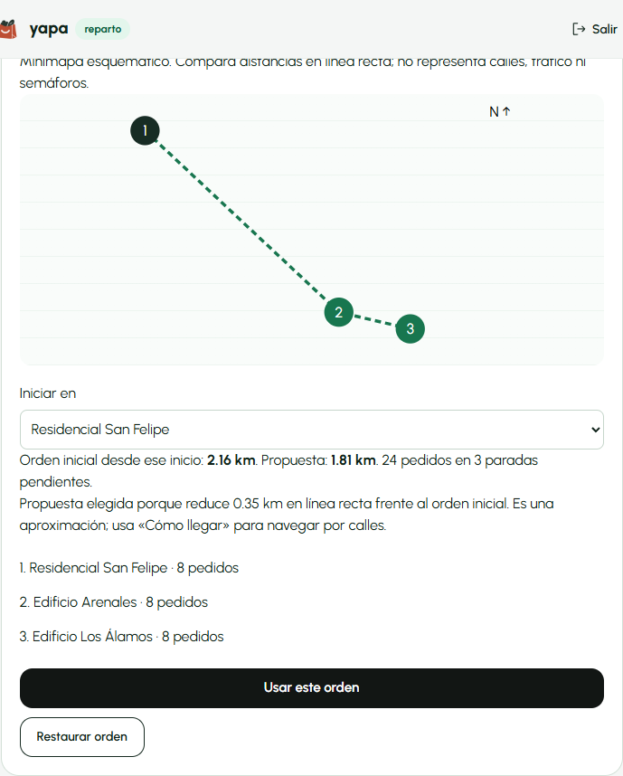
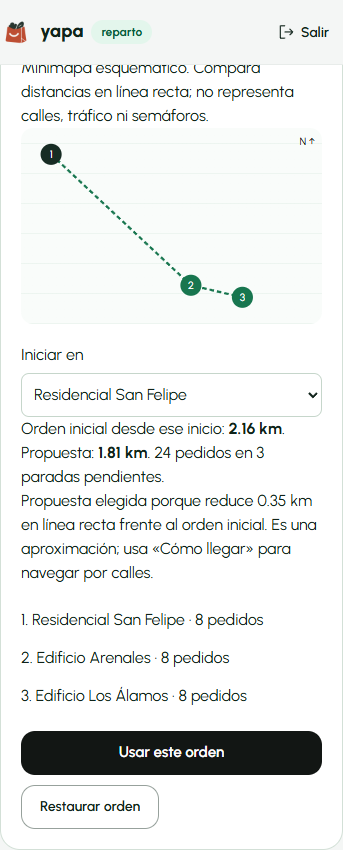

# Minimapa y orden local de reparto

Rama `aaron/ruta-transportista`, independiente y basada en main `1942dea`.

Reparto muestra un mapa esquemático SVG con las coordenadas existentes, números y una línea entre las zonas pendientes. No descarga mapas, no usa ubicación GPS, APIs ni servicios nuevos. Una zona agrupa sus pedidos en una parada.

Se elige una zona como inicio. El algoritmo de vecino cercano y mejora 2-opt compara su propuesta con el orden inicial desde ese mismo inicio; conserva la de menor longitud. Es un recorrido abierto, sin regreso automático al inicio. Una zona en camino se mantiene primero. Las completadas quedan al final; las que no tienen coordenadas se conservan al final de las pendientes y se avisa que no entraron en el cálculo. Hasta 100 puntos se optimizan; por encima se conserva el orden inicial.

La distancia es geográfica en línea recta, NO distancia por calles. El texto no afirma conocer tráfico, semáforos o intersecciones. No es un modelo entrenado ni garantiza el óptimo global. «Cómo llegar» conserva el enlace de navegación que ya tenía Yapa; abrirlo es opcional.





## Probar y arrancar

```powershell
cd "C:\Users\aaroo\Documents\DesignSoftware-projectU\Yapa-ruta-transportista"
npm.cmd ci
npm.cmd run typecheck
npm.cmd test
npm.cmd run build
python api/tools/servir_pruebas_roles.py --puerto 8014
```

Abrir http://127.0.0.1:8014/equipo?rol=transportista. Usuario `reparto-demo`, clave `reparto-yapa-2026`. La demo crea en memoria tres zonas con pedidos ficticios verificados; no son pagos reales. No abre bases existentes y las fotos temporales de esta demo se descartan al detenerla. Ctrl+C detiene el proceso.

Elegir inicio, pulsar «Usar este orden» y comprobar que cambia la lista; «Restaurar orden» vuelve al original. El orden solo vive en la pantalla. No registra salidas ni entregas; esos botones mantienen sus permisos y requisitos de bolsas y compras.

Para la demo habitual, también sirve `python api/tools/servir_demo.py --puerto 8014 --estaticos dist`, pero la semana abierta trae pocos pagos verificados y puede no tener grupos atendidos.

## Validación local, 14/11/2026

- 196 pruebas frontend aprobadas, TypeScript y build aprobados. Casos vacíos, empates, coordenadas inválidas, paradas en camino/completadas y prueba de que no empeora 20 recorridos de muestra.
- Chrome de pruebas con sesión y API reales de la demo: tres zonas, aplicación y restauración del orden, escritorio y 390 px. Cero solicitudes externas y ninguna acción POST de entrega durante la prueba.
- No cambiaron reglas del backend ni la infraestructura. El aviso previo de Vite por chunk mayor de 500 kB continúa. No se desplegó en producción.
