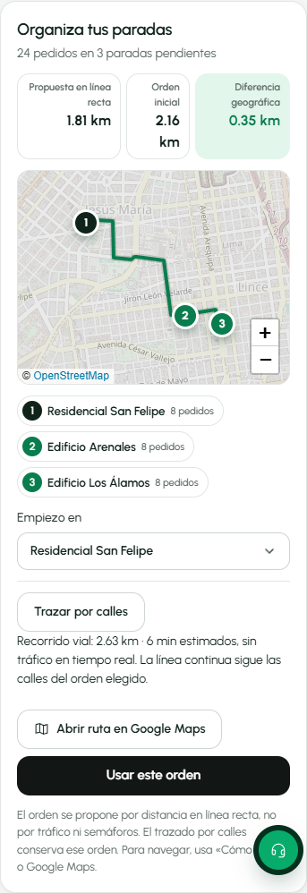

# Mapa y recorrido por calles

Rama `aaron/ruta-transportista`, actualizada a main `8b24c0e` el 17/11/2026. Conserva Leaflet/OpenStreetMap y la ruta completa en Google Maps añadidos por Kalos.

## Uso y límites

Reparto agrupa pedidos por zona. El orden sugerido usa vecino cercano y mejora 2-opt con distancias geográficas; mantiene primero una zona en camino, avisa si faltan coordenadas y no empeora la distancia de referencia. Es un recorrido abierto, sin regreso automático al inicio. No garantiza el óptimo global ni usa tráfico o semáforos.

«Trazar por calles» consulta OSRM desde el backend para dibujar el recorrido vial del orden elegido: línea continua, distancia por carretera y tiempo estimado sin tráfico en tiempo real. Antes de calcular, la línea discontinua solo une las paradas. Cambiar el inicio o las paradas invalida el trazado anterior. «Usar este orden» aplica el orden a la lista; no registra entregas ni salidas.

El trazado admite entre 2 y 25 zonas pendientes atendidas de la semana, con sesión y CSRF. El backend deriva sus coordenadas: no acepta destinos arbitrarios. Si el servicio falla, conserva el orden y los enlaces de navegación; no presenta una recta como ruta vial. Las zonas sin coordenadas se mantienen en la lista, fuera del trazado.



## Servicio de rutas

Se usa `YAPA_ROUTING_URL`, por defecto `https://router.project-osrm.org`. Es una dependencia externa para el prototipo académico, sin clave y sin instalar bibliotecas nuevas. Hay timeout de 7 s, límites de respuesta, caché de 10 minutos y máximo global de una solicitud por segundo en este proceso. Para producción se debe escoger un servicio con capacidad y condiciones adecuadas o alojar OSRM y sus datos viales; no se promete disponibilidad del servidor de demostración.

En AWS esta implementación requiere salida HTTPS al servicio de rutas y las teselas ya utilizadas por el mapa. No necesita un LLM, GPU, un programa nuevo o más RAM para consultar ese servicio. Alojar OSRM sería una instalación diferente con datos y recursos propios, que no se realizó. No se modificaron AWS, DNS o secretos. Las coordenadas de las zonas se envían al servicio cuando se pulsa el botón; la demo se probó con coordenadas de zonas ficticias de prueba.

## Arranque local

Desde la raíz del repo:

```bash
npm ci && npm run build
python3 api/tools/servir_pruebas_roles.py --puerto 8024
```

Abrir http://ruta.localhost:8024/equipo?rol=transportista. Usuario `reparto-demo`, clave `reparto-yapa-2026`. Elegir inicio, trazar por calles, aplicar o restaurar el orden y abrir Google Maps si se desea. La demo crea pedidos y pagos ficticios en memoria; no abre bases anteriores. Ctrl+C la detiene.

## Validación, 17/11/2026

- 768 pruebas del motor: 764 aprobadas y 4 omitidas; 213 web, TypeScript y build aprobados. Evidencias 74-ruta-*-verde.txt. Se cubren caché, permisos, coordenadas derivadas, timeout, respuesta inválida y errores sin geometría falsa; las pruebas unitarias simulan la API externa.
- Chrome con API local y OSRM real: HTTP 200, 92 vértices y recorrido de 2,63 km para tres zonas de la demo; cambio de inicio elimina el trazado anterior. Vista a 390 px. Los resultados pueden variar si cambian los datos del proveedor.
- [Spec y trazabilidad](../../api/docs/desarrollo/74-ruta-por-calles.md). Permanece el aviso de Vite por chunk grande. No se desplegó en producción.
